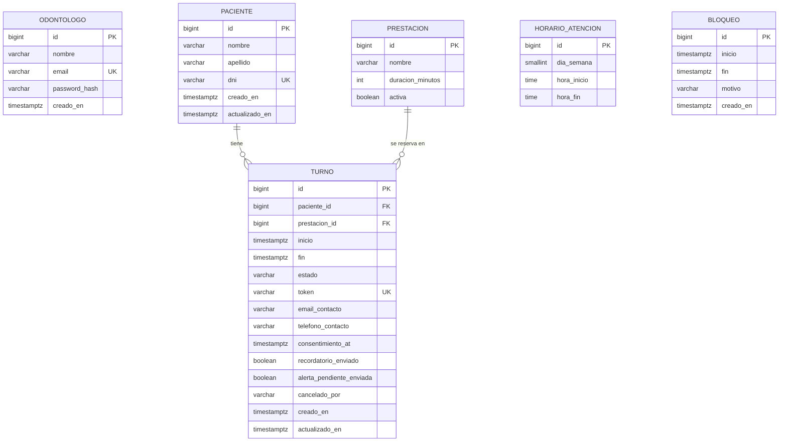
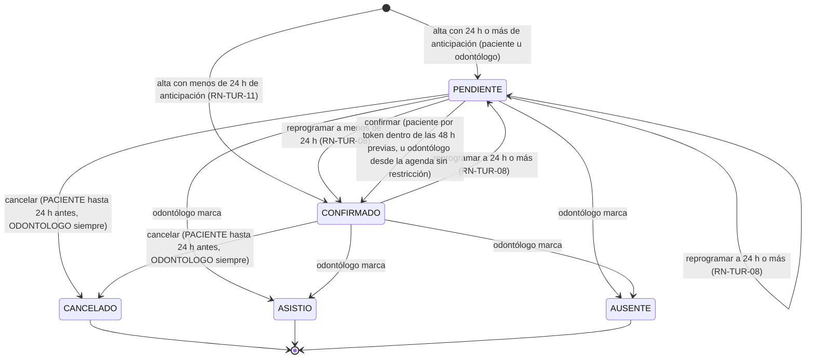

# Modelo de Datos

El esquema lo genera Hibernate (`ddl-auto=update`); la restricción de no solapamiento se agrega con `schema-extra.sql` (ver [08](08_arquitectura_propuesta.md) y DD-04 en [09](09_decisiones_y_supuestos.md)).

## Dominios

| Dominio | Entidades | Descripción |
|---------|-----------|-------------|
| Identidad | Odontologo (Usuario) | Único usuario con login |
| Catálogo | Prestacion | Tipos de atención con duración propia |
| Disponibilidad | HorarioAtencion, Bloqueo | Cuándo se atiende y cuándo no |
| Pacientes | Paciente | Datos mínimos de identificación (nombre, apellido, DNI), identificado por DNI. No guarda datos de contacto |
| Agenda | Turno | Reserva de un paciente para una prestación. Guarda el email y teléfono de contacto de ese turno |

**Los "horarios libres" no son una entidad ni una tabla.** No existe `horario_libre` en el modelo: se calculan al vuelo en cada consulta a `GET /api/disponibilidad` (y su versión pública) como horarios de atención − bloqueos − turnos activos − pasado − ventana de reserva (mínimo 2 h y máximo 60 días, RN-DIS-06). Ver [08](08_arquitectura_propuesta.md#cálculo-de-horarios-libres).

## ERD



`Odontologo`, `HorarioAtencion` y `Bloqueo` no tienen FK entre sí: hay un solo profesional y un solo sillón, así que no hace falta `odontologo_id` en el resto (se puede agregar si se quiere preparar multiprofesional, pero no se hace en v1).

## Entidades

### Odontologo (tabla `odontologo`)
- `id` bigint PK; `nombre` varchar(100); `email` varchar(150) único, not null; `password_hash` varchar(100) not null (BCrypt); `creado_en` timestamptz.
- Constraints: email único. Índice por la unicidad.
- Se crea por seed (ver abajo). No hay endpoint de registro.

### Paciente (tabla `paciente`)
- `id` bigint PK; `nombre`, `apellido` varchar(100) not null; `dni` varchar(15) not null **único**; `creado_en`, `actualizado_en` timestamptz.
- El paciente **no tiene email ni teléfono**: los datos de contacto pertenecen al turno (`email_contacto`, `telefono_contacto`), porque el paciente anónimo los ingresa en cada reserva y no queremos que alguien con un DNI ajeno pise datos de otro.
- Los datos del paciente no se modifican al reservar online con un DNI existente (aunque nombre o apellido difieran): solo los edita el odontólogo desde el ABM (RN-PAC-04).
- Relaciones: 1 paciente — N turnos.
- Constraints: `dni` único (RN-PAC-01).
- Índices: único en `dni`; opcional en `apellido` para búsqueda.
- Normalizar DNI: solo dígitos (sin puntos).

### Prestacion (tabla `prestacion`)
- `id` bigint PK; `nombre` varchar(100) not null; `duracion_minutos` int not null (> 0, múltiplo del paso de grilla recomendado, ver SU-04); `activa` boolean not null default true.
- Relaciones: 1 prestación — N turnos.
- Constraints: `duracion_minutos > 0` (CHECK o validación Bean Validation).
- No se borra si tiene turnos; se desactiva (RN-PRE-03).

### HorarioAtencion (tabla `horario_atencion`)
- `id` bigint PK; `dia_semana` smallint 1..7 (ISO: 1 = lunes, 7 = domingo); `hora_inicio` time not null; `hora_fin` time not null.
- Pueden existir varios rangos por día (ej. 09:00-13:00 y 15:00-19:00).
- Constraints: `hora_inicio < hora_fin`; rangos del mismo día sin solaparse (validación en service, RN-HOR-02).
- Horas locales de Buenos Aires (`time` sin zona), recurrentes semanalmente.
- Índice: `dia_semana`.

### Bloqueo (tabla `bloqueo`)
- `id` bigint PK; `inicio`, `fin` timestamptz not null; `motivo` varchar(200) null; `creado_en` timestamptz.
- Constraints: `inicio < fin`.
- Índice: `(inicio, fin)` para consultas por rango.
- Los bloqueos pueden solaparse entre sí; la unión es lo que bloquea.

### Turno (tabla `turno`)
- `id` bigint PK; `paciente_id` FK not null; `prestacion_id` FK not null; `inicio` timestamptz not null; `fin` timestamptz not null (= inicio + duración de la prestación al momento de reservar, **se persiste**); `estado` varchar(20) not null (enum `PENDIENTE|CONFIRMADO|CANCELADO|ASISTIO|AUSENTE`, `@Enumerated(STRING)`); `token` varchar(64) **único**, not null; `email_contacto` varchar(150) not null; `telefono_contacto` varchar(30) not null; `consentimiento_at` timestamptz null (instante en que el paciente aceptó el tratamiento de datos, RN-DAT-02; null en los turnos cargados por el odontólogo); `recordatorio_enviado` boolean not null default false; `alerta_pendiente_enviada` boolean not null default false; `cancelado_por` varchar(20) null (`PACIENTE|ODONTOLOGO`, solo si estado = CANCELADO); `creado_en`, `actualizado_en` timestamptz.
- Todos los avisos al paciente de ese turno (confirmación, recordatorio, reprogramación, cancelación) se envían a `email_contacto`, que se copia de lo ingresado al reservar (o de lo que cargó el odontólogo). El odontólogo ve `telefono_contacto` en la agenda para poder llamar al número con el que se reservó.
- `recordatorio_enviado` nace en `false` en los turnos `PENDIENTE` y en `true` en los que nacen `CONFIRMADO` (no reciben recordatorio, RN-NOT-04). En un turno `PENDIENTE` creado entre 24 h y 48 h pasa a `true` apenas se envía el Recordatorio al crear; si ese envío falla queda en `false` y lo reintenta el job. El job selecciona turnos `PENDIENTE` con inicio a 48 h o menos y `recordatorio_enviado = false` (RN-NOT-02). Se reinicia al reprogramar según la anticipación (RN-NOT-03).
- `alerta_pendiente_enviada` marca que ya se avisó al odontólogo por este turno pendiente a menos de 24 h (RN-NOT-06); se reinicia al reprogramar.
- Relaciones: N turnos — 1 paciente; N turnos — 1 prestación.
- Constraints:
  - `fin > inicio`.
  - `cancelado_por` not null si y solo si `estado = 'CANCELADO'` (validación en service; CHECK opcional).
  - **Exclusión de solapamiento** (en `schema-extra.sql`), solo para turnos activos:
    ```sql
    CREATE EXTENSION IF NOT EXISTS btree_gist
    ^^^
    DO $$ BEGIN
      IF NOT EXISTS (SELECT 1 FROM pg_constraint WHERE conname = 'turno_sin_solapamiento') THEN
        ALTER TABLE turno ADD CONSTRAINT turno_sin_solapamiento
          EXCLUDE USING gist (tstzrange(inicio, fin) WITH &&)
          WHERE (estado IN ('PENDIENTE','CONFIRMADO'));
      END IF;
    END $$
    ^^^
    ```
    `tstzrange` es semiabierto `[)`: un turno que termina a las 10:00 no choca con otro que empieza a las 10:00 (RN-TUR-02). El script usa `^^^` como separador de sentencias (en vez de `;`) porque Spring parte el script por `;` y eso rompería el bloque `DO $$ ... $$`; se configura con `spring.sql.init.separator=^^^`. El script usa `^^^` como separador de sentencias (en vez de `;`) porque Spring parte el script por `;` y eso rompería el bloque `DO $$ ... $$`; se configura con `spring.sql.init.separator=^^^`. El script es idempotente (ver [08](08_arquitectura_propuesta.md#esquema-de-base-de-datos)): `IF NOT EXISTS` en la extensión y chequeo en `pg_constraint` antes de crear la constraint, por eso puede correr en cada arranque. Esta constraint solo cubre el solapamiento entre turnos: horario de atención, bloqueos, pasado y ventana los valida el backend (RN-DIS-05).
- Índices: único en `token`; `(inicio)` para agenda; `(estado, inicio)` parcial o compuesto para las consultas del job de recordatorios y alertas.
- El nombre del estado `ASISTIO` no lleva tilde en el enum; en pantalla se muestra "Asistió".

## Máquina de estados del turno



- Activos (ocupan el horario): `PENDIENTE`, `CONFIRMADO`.
- El estado inicial depende de la anticipación al crear el turno (reserva pública o carga manual): 24 h o más, `PENDIENTE`; menos de 24 h, `CONFIRMADO` (RN-TUR-11).
- Reprogramar aplica la misma regla que al crear (RN-TUR-08, RN-TUR-11): con el nuevo inicio a 24 h o más el turno queda (o vuelve a) `PENDIENTE`; a menos de 24 h queda `CONFIRMADO`.
- Terminales: `CANCELADO` (registra `cancelado_por`), `ASISTIO`, `AUSENTE`. Un turno terminal no vuelve a activo.
- Reprogramar no es un estado: cambia `inicio`/`fin` del turno activo y recalcula el estado según la anticipación (RN-TUR-08).
- El odontólogo puede confirmar un turno `PENDIENTE` desde la agenda (US-021), por ejemplo después de hablar con el paciente por teléfono. Puede hacerlo en cualquier momento, sin la restricción de 48 h que sí rige para el paciente (RN-NOT-08). Los `PENDIENTE` a menos de 24 h se resaltan en la agenda para que decida confirmar o cancelar (US-009, US-022).
- `ASISTIO` y `AUSENTE` solo se pueden marcar desde la hora de inicio del turno (US-013).
- Corrección de error del odontólogo (ej. marcar ausente por error): decisión abierta, ver [10](10_preguntas_abiertas.md).

## Almacenamiento y zona horaria

- Todo instante se guarda como `timestamptz` (Postgres lo guarda en UTC). En Java: `java.time.Instant` o `OffsetDateTime`. Hibernate: `hibernate.jdbc.time_zone=UTC`.
- La zona operativa es `America/Argentina/Buenos_Aires` (UTC-3, sin horario de verano). Los `HorarioAtencion` son horas locales; al calcular disponibilidad se convierten a instantes con `ZoneId.of("America/Argentina/Buenos_Aires")`.
- La API devuelve instantes en ISO-8601 con offset (ej. `2026-11-25T10:00:00-03:00`); el front los muestra en hora de Buenos Aires.

## Seed data inicial

Se ejecuta al arrancar si no existe (idempotente), por un `CommandLineRunner`:

| Dato | Valores |
|------|---------|
| Odontólogo | `nombre`, `email` y contraseña tomados de `SEED_ODONTOLOGO_NOMBRE`, `SEED_ODONTOLOGO_EMAIL`, `SEED_ODONTOLOGO_PASSWORD` (hash BCrypt). Solo se crea si no hay ninguno. Usa **datos ficticios** (por ejemplo `odontologo@ejemplo.com`), nunca un nombre o email real. Ese email es el que recibe las alertas de turnos pendientes (en dev llegan a Mailpit). |
| Prestaciones | Consulta (30 min), Limpieza (45 min), Extracción (45 min), Arreglo / caries (60 min) |
| Horarios de ejemplo | Lunes a viernes, 09:00-13:00 y 15:00-19:00. Sábado y domingo sin atención. |

Las prestaciones y horarios de ejemplo se cargan solo si sus tablas están vacías al arrancar (ver [10](10_preguntas_abiertas.md)).
