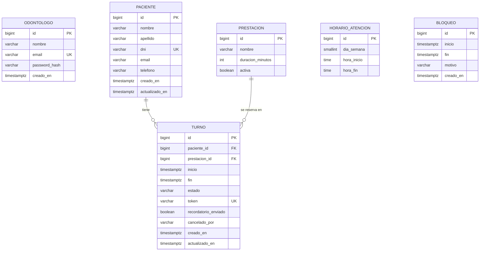
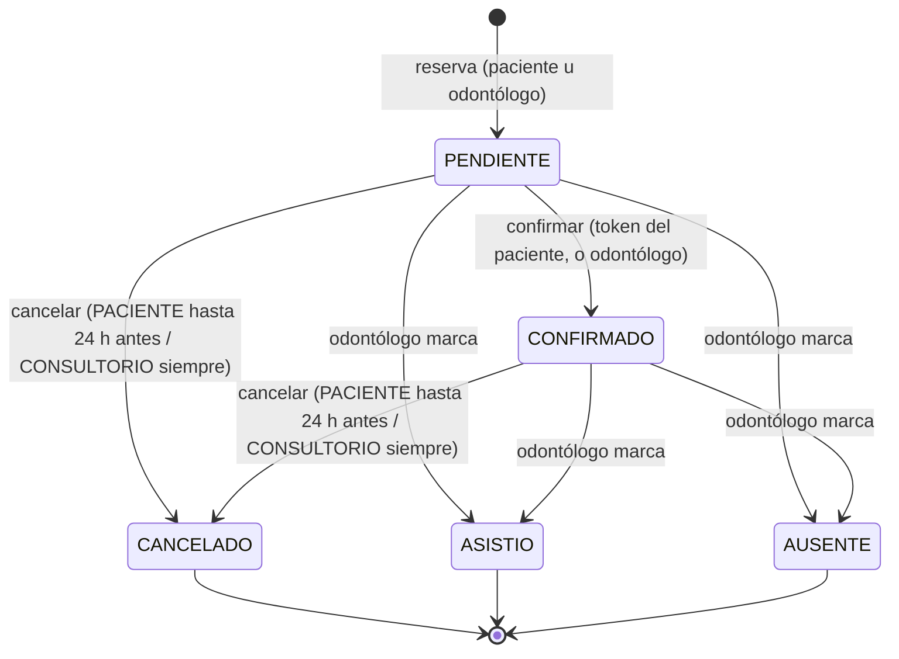

# Modelo de Datos

El esquema lo genera Hibernate (`ddl-auto=update`); la restricción de no solapamiento se agrega con `schema-extra.sql` (ver [08](08_arquitectura_propuesta.md) y DD-04 en [09](09_decisiones_y_supuestos.md)).

## Dominios

| Dominio | Entidades | Descripción |
|---------|-----------|-------------|
| Identidad | Odontologo (Usuario) | Único usuario con login |
| Catálogo | Prestacion | Tipos de atención con duración propia |
| Disponibilidad | HorarioAtencion, Bloqueo | Cuándo se atiende y cuándo no |
| Pacientes | Paciente | Datos mínimos, identificado por DNI |
| Agenda | Turno | Reserva de un paciente para una prestación |

## ERD



`Odontologo`, `HorarioAtencion` y `Bloqueo` no tienen FK entre sí: hay un solo profesional y un solo sillón, así que no hace falta `odontologo_id` en el resto (se puede agregar si se quiere preparar multiprofesional, pero no se hace en v1).

## Entidades

### Odontologo (tabla `odontologo`)
- `id` bigint PK; `nombre` varchar(100); `email` varchar(150) único, not null; `password_hash` varchar(100) not null (BCrypt); `creado_en` timestamptz.
- Constraints: email único. Índice por la unicidad.
- Se crea por seed (ver abajo). No hay endpoint de registro.

### Paciente (tabla `paciente`)
- `id` bigint PK; `nombre`, `apellido` varchar(100) not null; `dni` varchar(15) not null **único**; `email` varchar(150) not null; `telefono` varchar(30) not null; `creado_en`, `actualizado_en` timestamptz.
- Relaciones: 1 paciente — N turnos.
- Constraints: `dni` único (RN-PAC-01). Email y teléfono NO son únicos (RN-PAC-03).
- Índices: único en `dni`; opcional en `apellido` para búsqueda.
- Normalizar DNI: solo dígitos (sin puntos).

### Prestacion (tabla `prestacion`)
- `id` bigint PK; `nombre` varchar(100) not null; `duracion_minutos` int not null (> 0, múltiplo del paso de grilla recomendado, ver SU-04); `activa` boolean not null default true.
- Relaciones: 1 prestación — N turnos.
- Constraints: `duracion_minutos > 0` (CHECK o validación Bean Validation).
- No se borra si tiene turnos; se desactiva (RN-PRE-03).

### HorarioAtencion (tabla `horario_atencion`)
- `id` bigint PK; `dia_semana` smallint 1..7 (ISO: 1 = lunes, 7 = domingo); `hora_inicio` time not null; `hora_fin` time not null.
- Pueden existir varios rangos por día (ej. 09:00-13:00 y 15:00-19:00).
- Constraints: `hora_inicio < hora_fin`; rangos del mismo día sin solaparse (validación en service, RN-HOR-02).
- Horas locales de Buenos Aires (`time` sin zona), recurrentes semanalmente.
- Índice: `dia_semana`.

### Bloqueo (tabla `bloqueo`)
- `id` bigint PK; `inicio`, `fin` timestamptz not null; `motivo` varchar(200) null; `creado_en` timestamptz.
- Constraints: `inicio < fin`.
- Índice: `(inicio, fin)` para consultas por rango.
- Los bloqueos pueden solaparse entre sí; la unión es lo que bloquea.

### Turno (tabla `turno`)
- `id` bigint PK; `paciente_id` FK not null; `prestacion_id` FK not null; `inicio` timestamptz not null; `fin` timestamptz not null (= inicio + duración de la prestación al momento de reservar, **se persiste**); `estado` varchar(20) not null (enum `PENDIENTE|CONFIRMADO|CANCELADO|ASISTIO|AUSENTE`, `@Enumerated(STRING)`); `token` varchar(64) **único**, not null; `recordatorio_enviado` boolean not null default false; `cancelado_por` varchar(20) null (`PACIENTE|CONSULTORIO`, solo si estado = CANCELADO); `creado_en`, `actualizado_en` timestamptz.
- Relaciones: N turnos — 1 paciente; N turnos — 1 prestación.
- Constraints:
  - `fin > inicio`.
  - `cancelado_por` not null si y solo si `estado = 'CANCELADO'` (validación en service; CHECK opcional).
  - **Exclusión de solapamiento** (en `schema-extra.sql`), solo para turnos activos:
    ```sql
    CREATE EXTENSION IF NOT EXISTS btree_gist;
    DO $$ BEGIN
      IF NOT EXISTS (SELECT 1 FROM pg_constraint WHERE conname = 'turno_sin_solapamiento') THEN
        ALTER TABLE turno ADD CONSTRAINT turno_sin_solapamiento
          EXCLUDE USING gist (tstzrange(inicio, fin) WITH &&)
          WHERE (estado IN ('PENDIENTE','CONFIRMADO'));
      END IF;
    END $$;
    ```
    `tstzrange` es semiabierto `[)`: un turno que termina a las 10:00 no choca con otro que empieza a las 10:00.
- Índices: único en `token`; `(inicio)` para agenda; `(estado, inicio)` parcial o compuesto para el job de recordatorios.
- El nombre del estado `ASISTIO` no lleva tilde en el enum; en pantalla se muestra "Asistió".

## Máquina de estados del turno



- Activos (ocupan el horario): `PENDIENTE`, `CONFIRMADO`.
- Terminales: `CANCELADO` (registra `cancelado_por`), `ASISTIO`, `AUSENTE`. Un turno terminal no vuelve a activo.
- Reprogramar no es un estado: cambia `inicio`/`fin` del turno activo (RN-TUR-08).
- Corrección de error del odontólogo (ej. marcar ausente por error): decisión abierta, ver [10](10_preguntas_abiertas.md).

## Almacenamiento y zona horaria

- Todo instante se guarda como `timestamptz` (Postgres lo guarda en UTC). En Java: `java.time.Instant` o `OffsetDateTime`. Hibernate: `hibernate.jdbc.time_zone=UTC`.
- La zona operativa es `America/Argentina/Buenos_Aires` (UTC-3, sin horario de verano). Los `HorarioAtencion` son horas locales; al calcular disponibilidad se convierten a instantes con `ZoneId.of("America/Argentina/Buenos_Aires")`.
- La API devuelve instantes en ISO-8601 con offset (ej. `2026-11-25T10:00:00-03:00`); el front los muestra en hora de Buenos Aires.

## Seed data inicial

Se ejecuta al arrancar si no existe (idempotente), por un `CommandLineRunner`:

| Dato | Valores |
|------|---------|
| Odontólogo | `nombre`, `email` y contraseña tomados de `SEED_ODONTOLOGO_NOMBRE`, `SEED_ODONTOLOGO_EMAIL`, `SEED_ODONTOLOGO_PASSWORD` (hash BCrypt). Solo se crea si no hay ninguno. |
| Prestaciones | Consulta (30 min), Limpieza (45 min), Extracción (45 min), Arreglo / caries (60 min) |
| Horarios de ejemplo | Lunes a viernes, 09:00-13:00 y 15:00-19:00. Sábado y domingo sin atención. |

Las prestaciones y horarios de ejemplo se cargan solo si sus tablas están vacías al arrancar (ver [10](10_preguntas_abiertas.md)).
