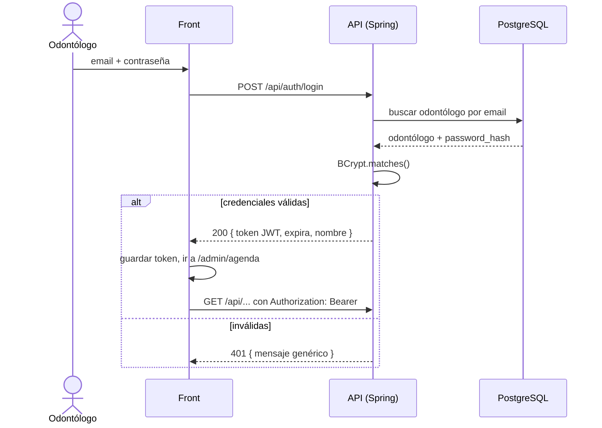
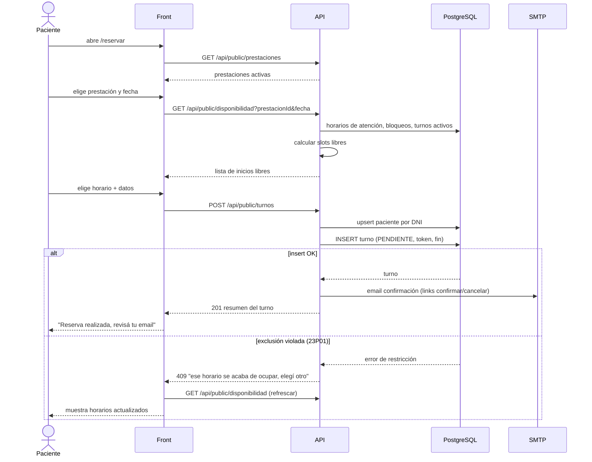
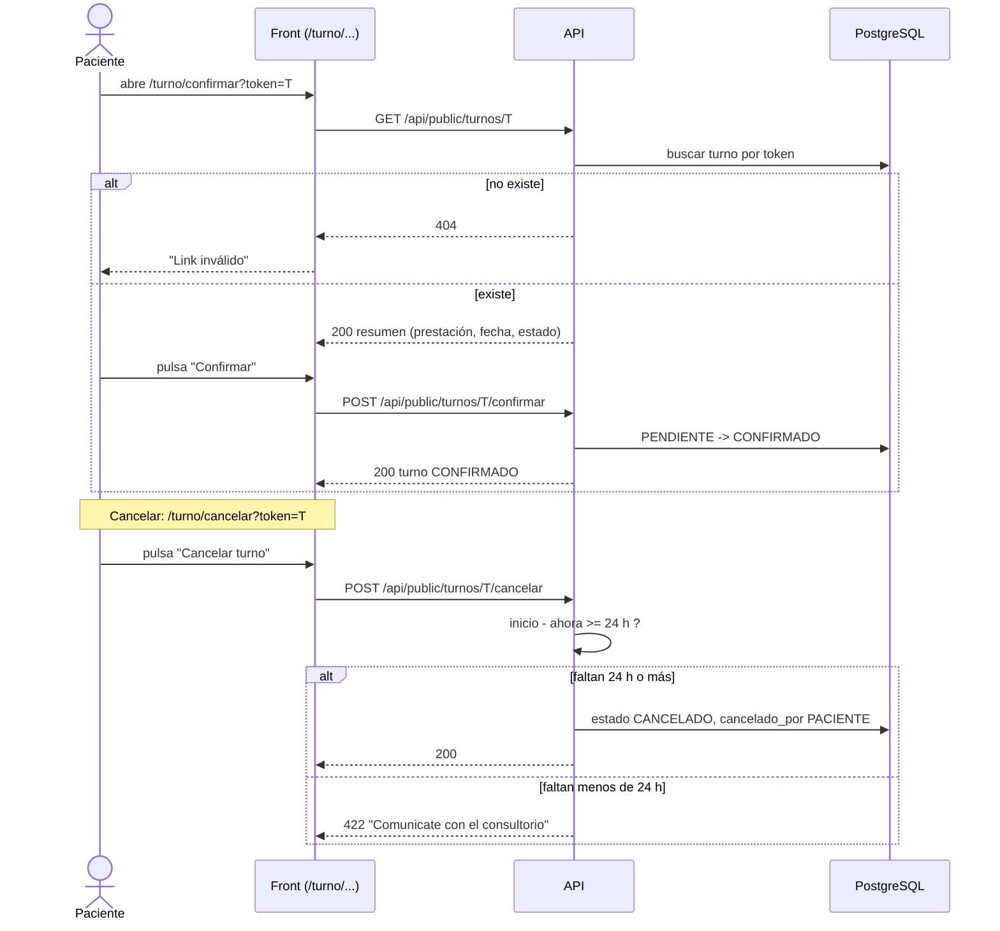
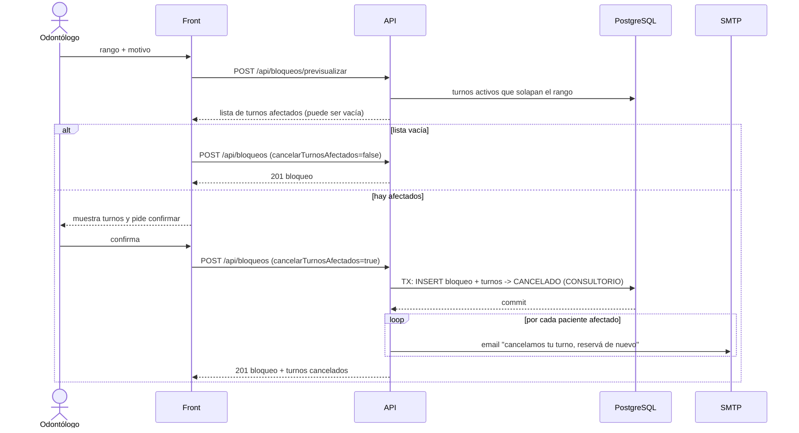
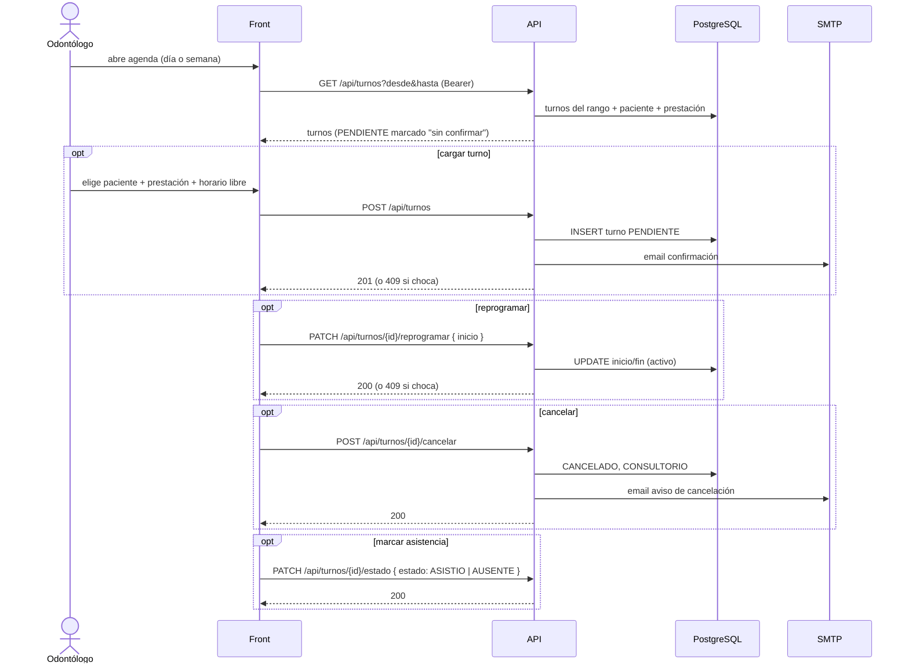

# Flujos Principales

Cada flujo se documenta extremo a extremo. Los endpoints son los del borrador de [08](08_arquitectura_propuesta.md); los nombres exactos los fija el change "contrato de API".

## Flujo 1: Login del odontólogo

**Disparador**: el odontólogo abre `/admin/login` y envía el formulario.
**Actor**: Odontólogo.



**Casos de error**:
- Credenciales inválidas → 401 genérico.
- Token vencido/ausente en ruta privada → 401; el front limpia el token y redirige al login.
- Body inválido → 400 con detalle por campo.

## Flujo 2: Reserva pública (incluida la carrera por el mismo horario)

**Disparador**: el paciente abre la página pública de reserva.
**Actor**: Paciente anónimo.

**Pasos**: elegir prestación → elegir fecha y horario libre → completar datos → reservar → ver confirmación → recibir email.



**Carrera de dos pacientes**: P1 y P2 ven libre el mismo horario y envían `POST` casi a la vez. Ambos pasan la validación de disponibilidad del service (que es solo informativa). Postgres serializa los `INSERT`: el primero en commitear gana; el segundo viola `turno_sin_solapamiento` y el backend lo traduce a 409. Es imprescindible que la inserción se haga en una transacción que se confirme/falle en el momento (`saveAndFlush`) para capturar la excepción dentro del service y no al final del request.

**Casos de error**:
- Datos inválidos (DNI, email) → 400 con detalle por campo.
- Prestación inexistente o inactiva → 404/422.
- Horario fuera de atención, en bloqueo o en el pasado → 422 (la validación del service repite el cálculo de disponibilidad).
- Fallo del email → la reserva queda creada; se registra en log (RN-NOT-05).

## Flujo 3: Confirmar o cancelar por token (regla de 24 h)

**Disparador**: el paciente hace clic en un link del email.
**Actor**: Paciente.



**Casos de error**:
- Token inexistente → 404.
- Confirmar un turno cancelado/pasado/terminal → 409/422 con mensaje.
- Cancelar con menos de 24 h → 422 con teléfono/contacto del consultorio (dato de configuración, ver [10](10_preguntas_abiertas.md)).
- Repetir la acción ya aplicada → 200 idempotente.

El front muestra siempre una pantalla con botón explícito (el GET solo lee; el cambio de estado es POST) para que los clientes de correo que precargan links no cancelen o confirmen solos.

## Flujo 4: Recordatorio programado

**Disparador**: `@Scheduled(fixedDelay = X minutos)` (por defecto 15 min, configurable).
**Actor**: Sistema.

```mermaid
sequenceDiagram
    participant J as Job @Scheduled
    participant DB as PostgreSQL
    participant M as SMTP
    loop cada X minutos
        J->>DB: turnos estado IN (PENDIENTE,CONFIRMADO), inicio entre ahora y ahora+48h, recordatorio_enviado=false
        DB-->>J: lista de turnos
        loop por cada turno
            J->>M: email recordatorio (links confirmar/cancelar)
            alt envío OK
                J->>DB: recordatorio_enviado = true
            else falla SMTP
                J->>J: log del error; sin marcar (reintenta en el próximo ciclo)
            end
        end
    end
```

**Casos de error**:
- SMTP caído → se reintenta en el próximo ciclo; no se detiene el resto del lote.
- Dos instancias del backend → no aplica en v1 (una sola instancia, SU-05).
- Turno reservado con menos de 48 h → recibe el recordatorio en el siguiente ciclo (RN-NOT-04).

## Flujo 5: Bloqueo con turnos afectados

**Disparador**: el odontólogo crea un bloqueo en `/admin/configuracion`.
**Actor**: Odontólogo.



**Casos de error**:
- Si aparece un turno nuevo entre la vista previa y la confirmación, el `POST` recalcula los afectados dentro de la transacción y cancela todos los vigentes; la respuesta devuelve los realmente cancelados. Si `cancelarTurnosAfectados=false` y hay afectados → 409 con la lista.
- Rango inválido (`inicio >= fin`) → 400.
- Falla de un email → se registra; el bloqueo y las cancelaciones no se revierten.

## Flujo 6: Gestión de agenda por el odontólogo

**Disparador**: el odontólogo abre `/admin/agenda`.
**Actor**: Odontólogo.



**Casos de error**:
- 401 → login. 404 turno inexistente. 409 por solapamiento. 422 por transición de estado inválida (ej. cancelar un turno ya `ASISTIO`).
