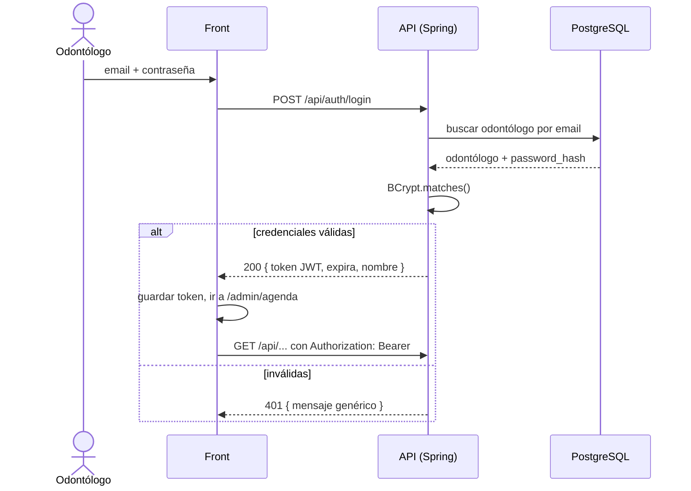
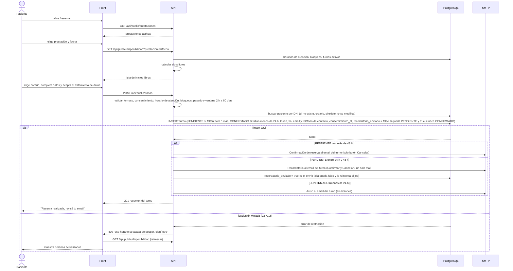
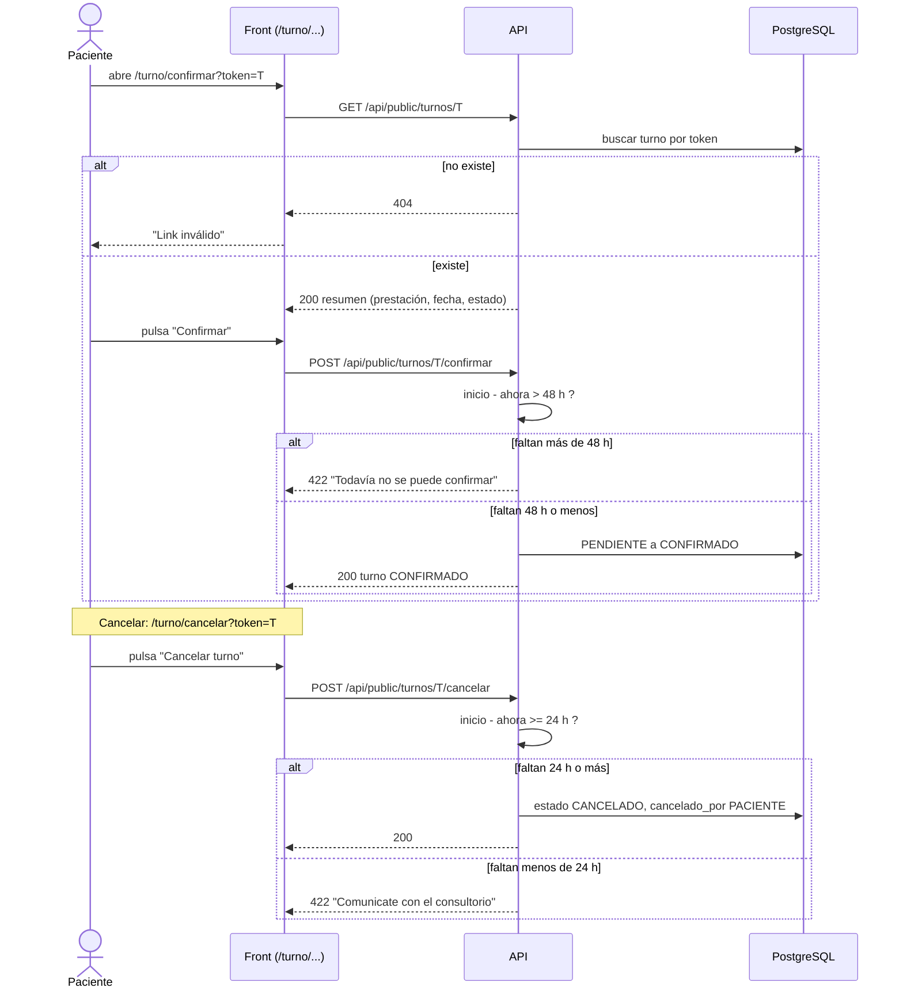
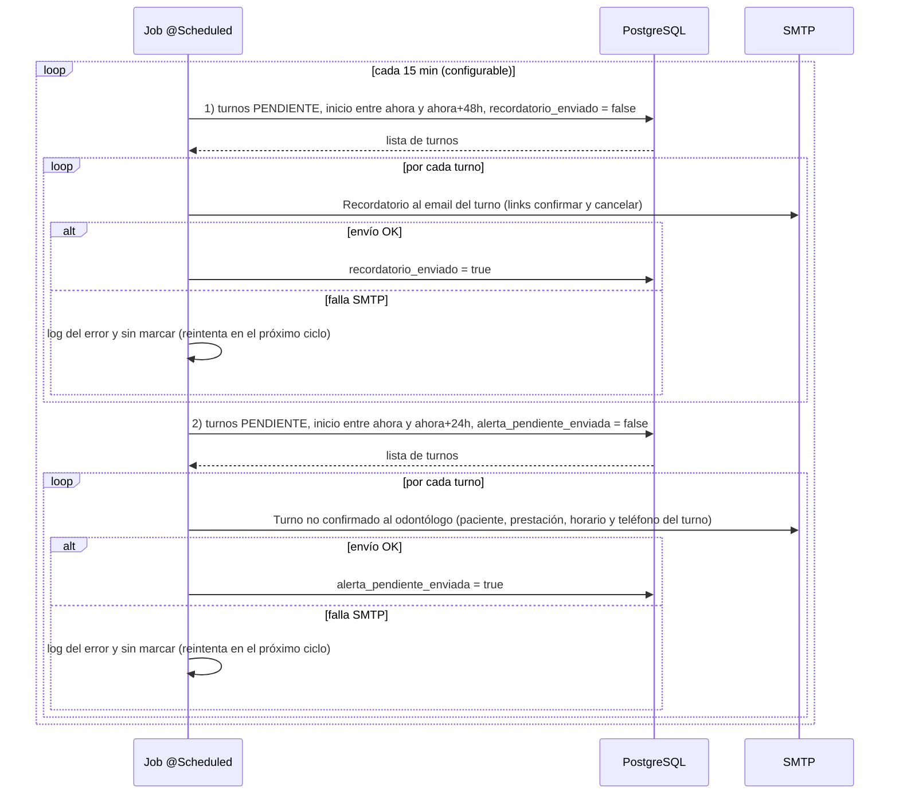
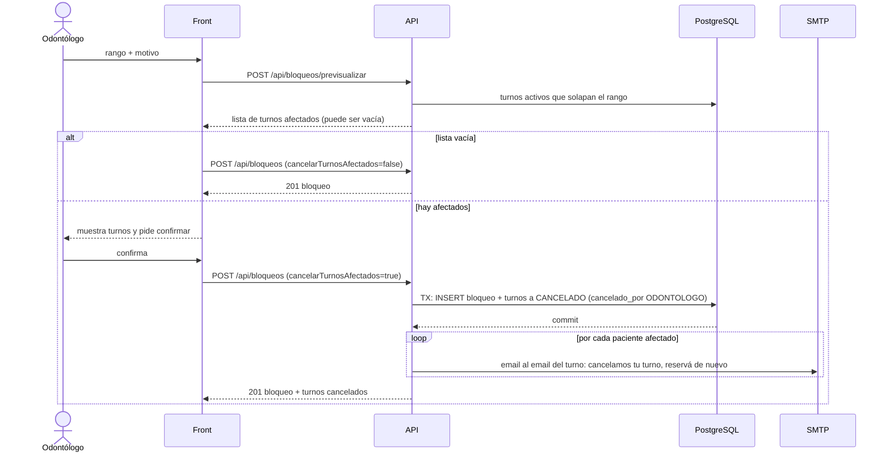
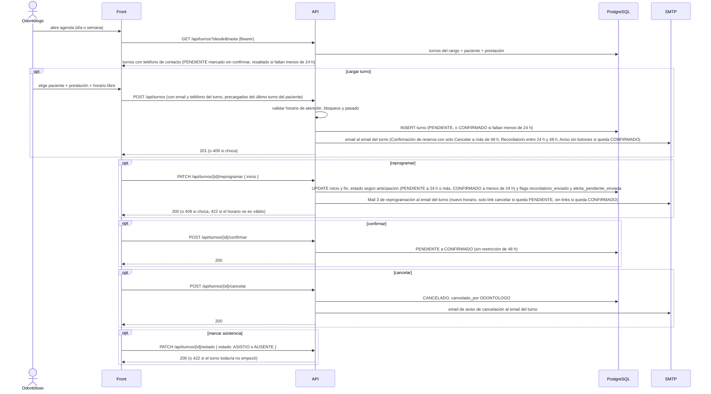

# Flujos Principales

Cada flujo se documenta extremo a extremo. Los endpoints son los del borrador de [08](08_arquitectura_propuesta.md); los nombres exactos los fija el change "contrato de API".

## Flujo 1: Login del odontólogo

**Disparador**: el odontólogo abre `/admin/login` y envía el formulario.
**Actor**: Odontólogo.

**Casos de error**:
- Credenciales inválidas → 401 genérico.
- Token vencido/ausente en ruta privada → 401; el front limpia el token y redirige al login.
- Body inválido → 400 con detalle por campo.

## Flujo 2: Reserva pública (incluida la carrera por el mismo horario)

**Disparador**: el paciente abre la página pública de reserva.
**Actor**: Paciente anónimo.

**Pasos**: elegir prestación → elegir fecha y horario libre → completar datos → reservar → ver confirmación → recibir email.

**Carrera de dos pacientes**: P1 y P2 ven libre el mismo horario y envían `POST` casi a la vez. Ambos pasan la validación de disponibilidad del service (que es solo informativa). El email y el teléfono de cada uno quedan en su propio turno, no en el paciente. Postgres serializa los `INSERT`: el primero en commitear gana; el segundo viola `turno_sin_solapamiento` y el backend lo traduce a 409. Es imprescindible que la inserción se haga en una transacción que se confirme/falle en el momento (`saveAndFlush`) para capturar la excepción dentro del service y no al final del request.

**Casos de error**:
- Formato inválido (DNI, email, teléfono) o body mal formado → 400 con detalle por campo.
- Casilla de tratamiento de datos sin aceptar → 422 (RN-DAT-02).
- Prestación inexistente → 404. Prestación inactiva → 422.
- Horario fuera de atención, sobre un bloqueo, en el pasado o fuera de la ventana de 2 h a 60 días → 422 (la validación del service repite el cálculo de disponibilidad, RN-DIS-05).
- Horario ocupado por otro turno (incluida la violación de la constraint) → 409.
- Turno entre 24 h y 48 h de anticipación → nace `PENDIENTE` y recibe un solo mail, el Recordatorio, enviado en el momento de crear (RN-NOT-04). Con menos de 24 h nace `CONFIRMADO` (RN-TUR-11) y recibe el Aviso sin botones.
- Fallo del email → la reserva queda creada, se registra en log (RN-NOT-05).

## Flujo 3: Confirmar o cancelar por token (reglas de 48 h y 24 h)

**Disparador**: el paciente hace clic en un link del email.
**Actor**: Paciente.

**Casos de error**:
- Token inexistente → 404.
- Confirmar un turno cancelado, pasado o terminal → 422 con mensaje.
- Confirmar con más de 48 h de anticipación → 422 (RN-NOT-08). El Recordatorio es el único mail con el link de Confirmar; el odontólogo puede confirmar desde la agenda sin esta restricción (RN-TUR-10).
- Cancelar con menos de 24 h → 422 con teléfono/contacto del consultorio (dato de configuración, ver [10](10_preguntas_abiertas.md)).
- Repetir la acción ya aplicada → 200 idempotente.

El front muestra siempre una pantalla con botón explícito (el GET solo lee y no cambia nada, el cambio de estado es POST) para que los clientes de correo y antivirus que abren los links solos no cancelen ni confirmen sin que el paciente haga nada (ver [03](03_actores_y_roles.md#por-qué-login-confirmar-y-cancelar-son-post)).

## Flujo 4: Recordatorio y alerta programados

**Disparador**: `@Scheduled(fixedDelay)` cada 15 min (configurable con `APP_RECORDATORIO_INTERVALO_MIN`).
**Actor**: Sistema.

Un mismo job hace dos tareas por ciclo: (1) Recordatorio al paciente, solo a turnos `PENDIENTE` con inicio a 48 h o menos y `recordatorio_enviado = false` (envía el de 48 h antes y reintenta los que fallaron al crear), y (2) mail "Turno no confirmado" al odontólogo por turnos `PENDIENTE` a menos de 24 h.

Cada ciclo ejecuta dos consultas baratas (con el índice `(estado, inicio)`); si no hay turnos que cumplan la condición no pasa nada más (ver DD-06).

**Qué pasa después de la alerta**: la agenda muestra esos turnos resaltados con el teléfono y botones Confirmar / Cancelar. El odontólogo se comunica por sus medios con el paciente y decide: `POST /api/turnos/{id}/confirmar` (US-021) o `POST /api/turnos/{id}/cancelar` (US-012, con email de aviso al paciente).

**Reglas de creación y reprogramación**:
- Un turno creado (reserva pública o carga manual) entre 24 h y 48 h recibe el Recordatorio sincrónicamente al crearse y queda con `recordatorio_enviado = true`; el job solo lo toma si ese envío falló (RN-NOT-04).
- Un turno creado con menos de 24 h nace `CONFIRMADO` (RN-TUR-11): no está pendiente, así que no entra en la alerta al odontólogo ni en el recordatorio. La alerta solo cubre turnos que siguen `PENDIENTE` al llegar a menos de 24 h (RN-NOT-06).
- Los turnos `CONFIRMADO` nunca reciben recordatorio (RN-NOT-02).
- Al reprogramar a 24 h o más el turno queda (o vuelve a) `PENDIENTE` y se reinician `recordatorio_enviado = false` y `alerta_pendiente_enviada = false`: el recordatorio sale al entrar en la ventana de 48 h, o en el siguiente ciclo si ya está dentro. El Mail 3 lleva solo el link de cancelar. Al reprogramar a menos de 24 h el turno queda `CONFIRMADO`, ambos flags en `true` y el Mail 3 es un aviso sin links (RN-TUR-08, RN-NOT-07).

**Casos de error**:
- SMTP caído → se reintenta en el próximo ciclo, no se detiene el resto del lote.
- Dos instancias del backend → no aplica en v1 (una sola instancia, SU-05).
- El paciente solo puede cancelar hasta 24 h antes: con menos, el link de cancelar rechaza con 422 (RN-CAN-02).

## Flujo 5: Bloqueo con turnos afectados

**Disparador**: el odontólogo crea un bloqueo en `/admin/configuracion`.
**Actor**: Odontólogo.

**Casos de error**:
- Si aparece un turno nuevo entre la vista previa y la confirmación, el `POST` recalcula los afectados dentro de la transacción y cancela todos los vigentes; la respuesta devuelve los realmente cancelados. Si `cancelarTurnosAfectados=false` y hay afectados → 409 con la lista.
- Rango inválido (`inicio >= fin`) → 422. Body mal formado → 400.
- Falla de un email → se registra; el bloqueo y las cancelaciones no se revierten.

## Flujo 6: Gestión de agenda por el odontólogo

**Disparador**: el odontólogo abre `/admin/agenda`.
**Actor**: Odontólogo.

**Casos de error**:
- 401 → login. 404 turno inexistente. 409 por solapamiento. 422 por transición de estado inválida (ej. cancelar un turno ya `ASISTIO`), por marcar asistencia antes de la hora de inicio o por horario inválido al cargar o reprogramar. 400 por body mal formado.
